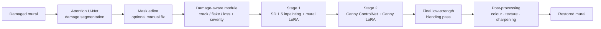
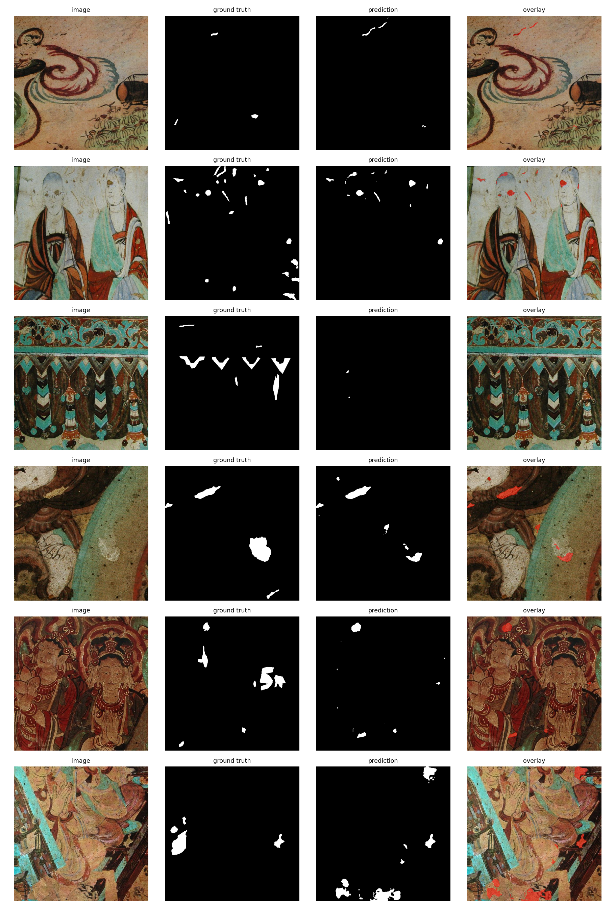

# AI-Based Mural Restoration Using Diffusion Models

A damage-aware restoration pipeline for ancient murals. An **Attention U-Net** finds the damage. A **damage-aware module** classifies each damaged region as a crack, a flake or a paint loss and estimates its severity. Two **Stable Diffusion** stages, fine-tuned with LoRA on Dunhuang murals, then repaint each region with a strength matched to that damage. A Streamlit app lets you upload a mural, edit the damage mask and compare the result with the original.

> Course project (AD23702), Dept. of Information Technology, AI & Data Science, Madras Institute of Technology, Anna University.

## Pipeline



| Stage | What it does | Weights |
|---|---|---|
| Segmentation | An Attention U-Net predicts a damage probability map, using a threshold tuned on validation data | `models/attention_unet.keras` |
| Damage-aware routing | Each connected region is measured (area, thickness, elongation), classified as crack, flake or loss, and given a denoising strength (0.45 / 0.75 / 1.0) scaled by severity. Every hole is pre-filled with Telea inpainting first. | (no weights, NumPy/OpenCV) |
| Stage 1 diffusion | SD 1.5 inpainting with a LoRA trained on 5,096 MuralDH murals (trigger `dunhuang_mural_style`) | `models/dunhuang_inpaint_lora.safetensors` |
| Stage 2 diffusion | Canny ControlNet with a Canny-tuned LoRA, which keeps line work and edges consistent | `models/dunhuang_canny_lora.safetensors` |
| Final pass | A low-strength (0.3) diffusion pass over each region plus an 8 px ring, so the seams blend | (same as Stage 1) |
| Post-processing | Colour matching, texture matching, edge-aware sharpening | (no weights) |

A **classical (CPU-only) mode** is also available. It runs the segmentation, damage analysis and Telea inpainting without any diffusion, for quick previews.

## Results

**Damage segmentation:** Attention U-Net on MuralDH, real damage annotations, 201 test images, threshold 0.3 chosen on 152 validation images.

| Split | Dice | IoU | Precision | Recall |
|---|---:|---:|---:|---:|
| Validation | 0.400 | 0.298 | 0.496 | 0.466 |
| Test | 0.283 | 0.190 | 0.464 | 0.283 |

Real mural damage is thin and irregular, and the annotations are sparse. Segmentation is the weakest stage, which is why the app includes a mask editor for manual correction.

**Restoration ablation:** 40 images, 30 steps, seed 42, paired tests on masked LPIPS and PSNR. Diffusion inpainting beats classical inpainting on perceptual quality (masked LPIPS −0.129, p < 1e-10). Its pixel-level PSNR is lower (−0.90 dB), as is typical for generative inpainting. The damage-aware module improves on fixed-strength diffusion (masked LPIPS −0.0017, p = 0.010; masked PSNR +0.22 dB, p = 0.013). The full per-variant numbers are in [`results/`](results/).



## Getting started

Requires Python 3.10 or 3.11. A CUDA GPU is strongly recommended, because diffusion on a CPU takes several minutes per image.

```bash
git clone https://github.com/BalaMSD7781/mural-restoration-diffusion.git
cd mural-restoration-diffusion
python -m venv .venv && .venv\Scripts\activate         # Linux/macOS: source .venv/bin/activate
pip install torch --index-url https://download.pytorch.org/whl/cu121   # or .../whl/cpu
pip install -r requirements.txt
streamlit run app.py
```

On Windows, the numbered scripts do the same steps: `1_SETUP_GPU.bat` (or `1_SETUP_CPU.bat`), then `2_SMOKE_TEST.bat`, `3_PRECOMPUTE.bat` and `4_RUN_DEMO.bat`.

**Model weights**

- Both LoRA files (~6 MB each) are already in `models/`.
- The Attention U-Net (`attention_unet.keras`, ~370 MB) is too large for Git. Place it at `models/attention_unet.keras`, or set `SEGMENTATION_MODEL_PATH`.
- The first diffusion run downloads SD 1.5 inpainting and the Canny ControlNet from Hugging Face (~4 GB).

**Configuration:** you can override `MURAL_DEVICE`, `SD_MODEL_ID`, `CONTROLNET_ID`, `MURAL_LORA_PATH`, `MURAL_LORA_SCALE`, `CANNY_LORA_PATH` and `CANNY_LORA_SCALE` with environment variables. The defaults are in [`config.py`](config.py).

## Training notebooks (Kaggle, 2× T4)

| Notebook | Purpose |
|---|---|
| `01_segmentation_eval.ipynb` | Evaluate the U-Net and sweep thresholds; writes `models/thresholds.json` |
| `03_canny_dataset.ipynb` | Build Canny edge maps for the mural dataset |
| `04_train_inpaint_lora.ipynb` | Train the Stage 1 mural-style inpainting LoRA |
| `05_train_canny_lora.ipynb` | Train the Stage 2 Canny ControlNet LoRA |
| `06_full_pipeline_kaggle.ipynb` | Run the full pipeline and ablation evaluation on Kaggle |
| `07_streamlit_app_kaggle.ipynb` | Serve the Streamlit demo from a Kaggle GPU |

## Tests

```bash
python -m unittest discover -s tests      # 28 tests for masks, damage analysis and routing; CPU only
```

## Project structure

```
app.py                 Streamlit app: upload, mask editor, restoration, side-by-side comparison
config.py              Paths, model registry, diffusion defaults, env overrides
model/
  damage_detector.py   Attention U-Net loading and inference
  damage_aware.py      Region analysis, damage-type routing, severity-adaptive strength
  diffusion_model.py   SD inpainting, ControlNet and LoRA stages
  postprocess.py       Colour/texture matching and sharpening
  inference.py         End-to-end restoration entrypoint
evaluation/            Segmentation (Dice/IoU) and restoration (PSNR/SSIM/LPIPS) metrics
tools/                 Smoke test, demo pre-computation, synthetic damage, dataset validation
notebooks/             Kaggle training and evaluation notebooks
results/               Evaluation JSON and figures
tests/                 Unit tests
```

## Team

Suriya Ganesh S · Syed Harshath S · **Balamurugan T** · Prithviraj P

Guided by Ms. D. Piratheba, Teaching Fellow, Dr. Kalam Computing Centre, MIT Anna University.

## Acknowledgements

The murals come from the **MuralDH** dataset of Dunhuang murals. Base models are Stable Diffusion 1.5 Inpainting and `lllyasviel/control_v11p_sd15_canny`.
